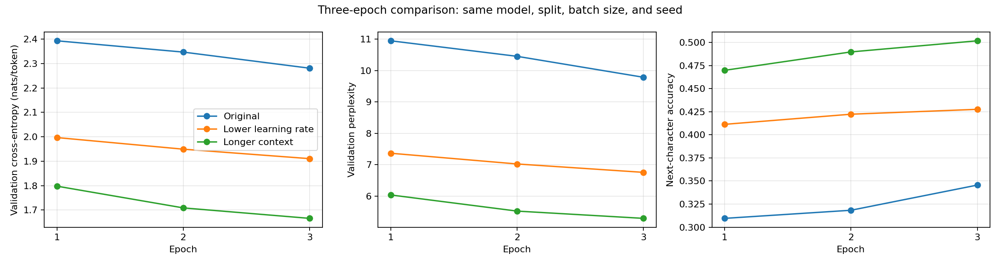
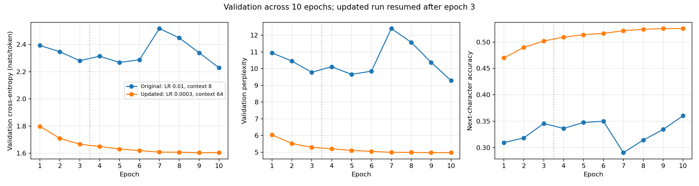
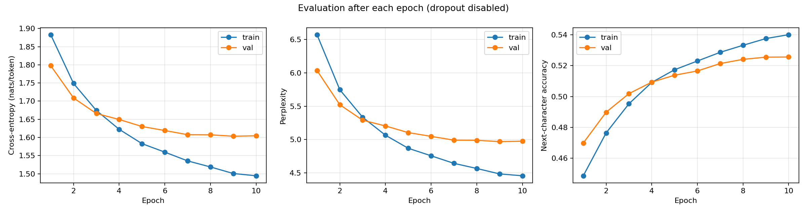

# Improving the Tiny Shakespeare baseline

Lowering the learning rate and increasing the context window improved this single-block character model. The selected checkpoint has validation loss **1.6033**, perplexity **4.970**, and next-character accuracy **52.55%**. It was selected at epoch 9 from a run that completed 10 epochs.

The architecture was unchanged: 512-dimensional embeddings, eight heads, RoPE, a 2,048-dimensional feed-forward network, and pre-normalization residual branches. Batch size remained four sequences. All runs used seed 42, Adam, the same character vocabulary, and a contiguous 80/10/10 split.

## First experiment: lower the learning rate

The initial question was whether learning rate 0.01 contributed to the unstable baseline. A fresh three-epoch run reduced only the learning rate to 0.0003. At epoch 3, validation loss improved from **2.2811 to 1.9106** with the same context, batch size, seed, and number of updates.

## Second experiment: extend context

A second fresh run kept the lower rate and increased context from 8 to 64 characters. Its three-epoch validation loss was **1.6660**.

| Configuration at epoch 3 | Learning rate | Context | Updates | Validation loss | Perplexity | Accuracy |
| --- | ---: | ---: | ---: | ---: | ---: | ---: |
| Original baseline | 0.01 | 8 | 83,652 | 2.2811 | 9.788 | 34.56% |
| Lower learning rate | 0.0003 | 8 | 83,652 | 1.9106 | 6.757 | 42.76% |
| Longer context at lower rate | 0.0003 | 64 | 10,455 | 1.6660 | 5.291 | 50.18% |



The context experiment also changes tokens per batch: four 64-character sequences contain eight times as many target tokens as four 8-character sequences. It therefore takes fewer updates per epoch. This compares configurations at similar corpus exposure, rather than isolating context length from batch token count or update count. Full-batch evaluation covers 111,520 targets with context 8 and 111,360 with context 64.

## Continue the promising configuration to 10 epochs

Validation loss decreased in all three initial epochs, so the 64-character run was resumed from its epoch-3 checkpoint through epoch 10. Model weights and Adam state were restored. The older checkpoint did not contain random-number-generator state; the continuation explicitly reset the seed to 42. This is not an exact replay of an uninterrupted run.

| Checkpoint | Epoch | Training loss | Validation loss | Validation perplexity | Validation accuracy |
| --- | ---: | ---: | ---: | ---: | ---: |
| Original baseline's best | 10 | 2.3152 | 2.2289 | 9.289 | 36.03% |
| Updated configuration's best | 9 | 1.5006 | 1.6033 | 4.970 | 52.55% |
| Updated configuration's final | 10 | 1.4943 | 1.6045 | 4.975 | 52.56% |



The updated configuration's selected validation loss is approximately **28.1% lower** than the original baseline's best. Perplexity fell from 9.289 to 4.970. These are validation measurements from single-seed experiments, not held-out test results.



Training loss continued decreasing, while validation improvement became small after epoch 7. Epoch 10 had slightly higher validation loss than epoch 9, so epoch 9 was selected. This small difference alone does not establish a clear overfitting trend or justify more training.

## Artifacts and verification

- [Matched three-epoch measurements](comparison.csv).
- [Complete longer-context history, epochs 1-10](long-context-history.csv).
- [Selected checkpoint's reloaded validation report](selected-validation.json).
- Selected model: epoch 9 of the continued 64-character-context run. Checkpoint retained locally and excluded from this repository.
- Continuation restored epoch-3 weights and Adam state; RNG seed was reset to 42.

Standalone validation reloaded the selected model and reproduced its loss, perplexity, and accuracy on 111,360 validation target tokens. Metrics were computed with dropout disabled and gradient tracking off. Incomplete batches were excluded.

The graphs and small result files in this folder are outside the ignored runs directory and can be included in GitHub preparation. Checkpoints remain local. No commit or push has been made.

## Reproduction and remaining work

The initial comparison used:

```powershell
python LLM/llm.py --epochs 3 --lr 0.0003 --seq-length 8
python LLM/llm.py --epochs 3 --lr 0.0003 --seq-length 64 --save-every 1000
```

A fresh ten-epoch run can use the following command. It will not exactly reproduce the resumed run because its dropout RNG sequence will be uninterrupted:

```powershell
python LLM/llm.py --epochs 10 --lr 0.0003 --seq-length 64 --save-every 1000
```

Source defaults remain unchanged, so explicit options matter. Text generation has not been implemented, generated-text quality has not been assessed, and the held-out test split remains unused. Those are the next useful steps before drawing broader conclusions about model quality.
