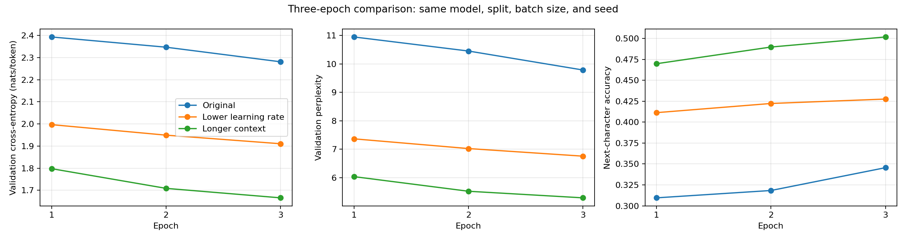
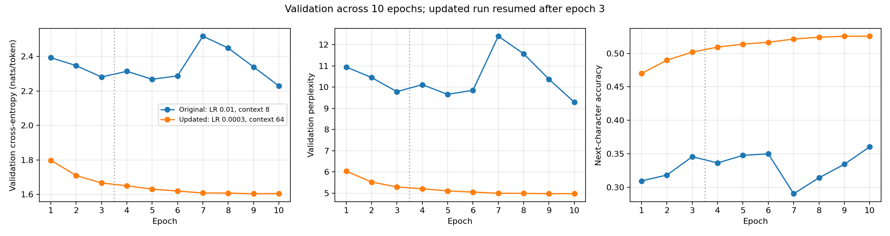
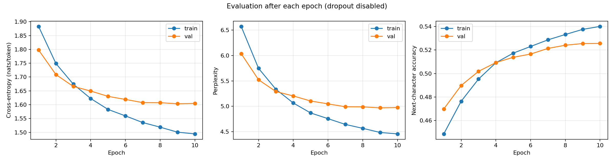

# Character-Level Transformer on Tiny Shakespeare

A learning project implementing a small decoder-only language model in PyTorch, then investigating how learning rate and context length affect next-character prediction.

The initial baseline used an 8-character context and Adam learning rate 0.01. Reducing the learning rate to 0.0003 and extending context to 64 characters improved the best validation loss from **2.229 to 1.603**. The architecture stayed the same.

## Model and data

- Character-level tokenizer with 65 characters, preserving spaces, punctuation, and newlines.
- Learned token embeddings and rotary positional embeddings (RoPE) on queries and keys.
- One Transformer block with causal multi-head self-attention, pre-normalization, residual connections, and a feed-forward network.
- A vocabulary projection trained with next-character cross-entropy.

Dataset: [Tiny Shakespeare](https://github.com/karpathy/char-rnn/blob/master/data/tinyshakespeare/input.txt), containing 1,115,394 characters. The sequence is divided into contiguous training, validation, and test portions using an 80/10/10 split before batching. Targets are shifted one character ahead of inputs.

## Experiment settings

| Setting | Value |
| --- | --- |
| Transformer blocks | 1 |
| Embedding dimension | 512 |
| Attention heads | 8 |
| Feed-forward dimension | 2,048 |
| Batch size | 4 sequences |
| Optimizer | Adam |
| Dropout | 0.1 before vocabulary projection |
| Seed | 42 |
| GPU | NVIDIA GeForce RTX 4080 SUPER |

The experiments first lowered the learning rate with context fixed at 8 characters, then tested 64-character context at the lower rate. Both new runs initially trained for three epochs from fresh initializations. The promising 64-character run was continued to 10 total epochs using saved model and optimizer state.

## Results

### Matched three-epoch comparison

| Configuration | Learning rate | Context | Validation loss | Perplexity | Next-character accuracy |
| --- | ---: | ---: | ---: | ---: | ---: |
| Original | 0.01 | 8 | 2.281 | 9.79 | 34.6% |
| Lower learning rate | 0.0003 | 8 | 1.911 | 6.76 | 42.8% |
| Longer context at lower rate | 0.0003 | 64 | 1.666 | 5.29 | 50.2% |



The learning-rate comparison holds architecture, context, batch size, seed, and update count fixed. Increasing context also increases tokens per batch and reduces updates per epoch, so that comparison does not isolate context length alone.

### Selection after 10 epochs

| Best checkpoint within each ten-epoch run | Selected epoch | Validation loss | Perplexity | Next-character accuracy |
| --- | ---: | ---: | ---: | ---: |
| Original baseline | 10 | 2.229 | 9.29 | 36.0% |
| Lower rate and longer context | 9 | **1.603** | **4.97** | **52.5%** |



The selected configuration reduced validation loss by approximately 28.1% relative to the original baseline's best checkpoint. The updated run completed 10 epochs; epoch 9 was selected because epoch 10's validation loss was slightly higher, at 1.605.



Metrics were computed with dropout disabled and gradient tracking off. The selected checkpoint was reloaded and its validation results reproduced on 111,360 target tokens. Incomplete batches were excluded. The resumed run restored weights and Adam state but reset the RNG seed because the original checkpoint did not store RNG state.

## What this shows

The original implementation ran, but its training settings limited the results. A lower learning rate improved the matched three-epoch baseline, and the longer-context configuration improved further. Checkpoints and validation made it possible to continue training and select a model using measured results.

These are single-seed exploratory experiments. Character accuracy does not establish readable generation quality. Text generation has not been implemented, and final held-out test evaluation has not been performed.

## Project files and training

```text
LLM/
  llm.py          Model and training entry point
  tokeniser.py    Character mappings, data splits, and batches
  checkpoint.py   Save and reload model and optimizer state
  validate.py     Evaluation, metric export, and graphs
  results/        Selected reports, CSV files, and figures
```

To start a fresh run with the updated settings from the workspace root:

```powershell
python LLM/llm.py --epochs 10 --lr 0.0003 --seq-length 64 --save-every 1000
```

This starts new training; it does not resume existing checkpoints. Source defaults remain the original values, so specify the options above. PyTorch is required; Matplotlib is required for graphs. See [the training instructions](LLM/README.md) for checkpoint and validation commands, and [the experiment report](LLM/results/hyperparameter-comparison/README.md) for detailed measurements and limitations.

## Next steps

- Implement autoregressive text generation and inspect samples.
- Run the selected checkpoint on the held-out test split after settling the experiment choices.
- Test whether improvements hold across additional seeds.
